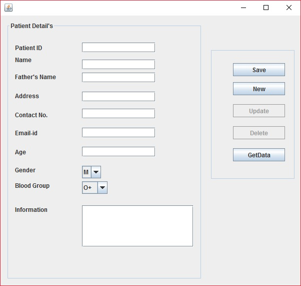
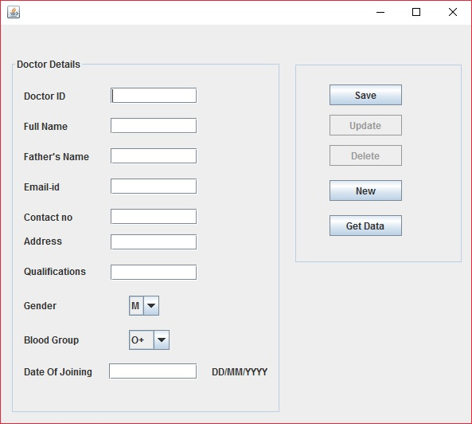
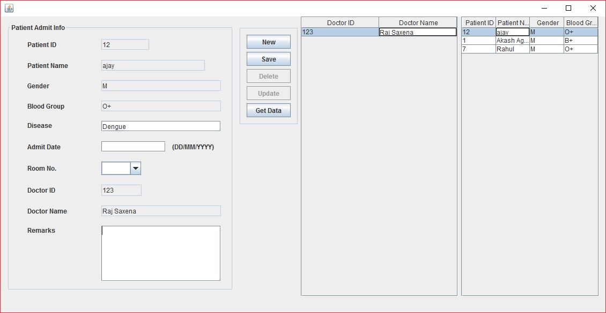

# Hospital Management System

A desktop Hospital Management System built with **Java Swing** and **MySQL**. Manages patient registration, doctor records, room admission/discharge, billing, and user accounts through a set of NetBeans-generated forms.

Originally built in 2018 as a university project; restored in 2026 to build and run on current tooling (JDK 17, MySQL 8.0) and re-skinned with a consistent, modern look. See [`RESTORE_NOTES.md`](RESTORE_NOTES.md) for the full list of what was fixed and why.

## Screenshots

| Patient Registration | Doctor Records | Patient Admission |
|---|---|---|
|  |  |  |

*(Screenshots are from the original UI; the current build uses a refreshed Nimbus-based theme — see "UI" below.)*

## Features

- **Authentication**: login, new user registration, change password
- **Doctor management**: add, update, delete, and browse doctor records
- **Patient management**: registration, service history, admission and discharge
- **Room management**: track room type, charges, and vacancy status
- **Billing**: compute room + service charges, record payment method, generate a bill number
- **Records views**: tabular browsing for all of the above (doctors, patients, rooms, services, users)

## Tech stack

| Layer | Technology |
|---|---|
| UI | Java Swing (NetBeans GroupLayout / AbsoluteLayout forms) |
| Language | Java (compiled at source/target 1.8, runs on JDK 17) |
| Database | MySQL 8.0 |
| DB driver | MySQL Connector/J 8.0.33 |
| Build | NetBeans/Ant project layout (`nbproject/`, `build.xml`); also builds directly with `javac`/`java` |

## Project structure

```
src/                  All Java source + NetBeans .form files (one class per screen)
  Connect.java         Central DB connection helper (reads db.properties)
  UITheme.java         App-wide Nimbus theme (colors/fonts) applied once at startup
  login.java           App entry point
  Main.java            Post-login dashboard/menu
  Entry.java            Doctor registration
  Registration.java    Patient registration
  Room.java / Bill_Room*.java / Patient_Admit_*.java / Patient_Discharge_*.java
                        Room, admission, discharge, and billing screens
  *Rec.java            Read-only tabular record views
dist/lib/              Bundled AbsoluteLayout + rs2xml jars
lib/                   MySQL Connector/J jar
hp_mgmt_db.sql          Database schema + seed data
screenshots/            Reference screenshots
ANALYSIS_REPORT.md      Code/security review of the current codebase (known issues)
RESTORE_NOTES.md        What was broken and how it was fixed to get this running today
```

## Getting started

### Prerequisites
- JDK 8+ (tested on JDK 17)
- MySQL Server 8.0, running locally

### 1. Create a database user and the database
Run as a MySQL admin (e.g. in MySQL Workbench):
```sql
CREATE USER IF NOT EXISTS 'hospital_app'@'localhost' IDENTIFIED BY 'your_password_here';
CREATE DATABASE IF NOT EXISTS hospital_management CHARACTER SET utf8mb4 COLLATE utf8mb4_unicode_ci;
GRANT ALL PRIVILEGES ON hospital_management.* TO 'hospital_app'@'localhost';
FLUSH PRIVILEGES;
```

### 2. Import the schema and seed data
```sh
mysql -u hospital_app -p hospital_management < hp_mgmt_db.sql
```

### 3. Configure credentials
```sh
cp db.properties.example db.properties
```
Edit `db.properties` with the username/password from step 1. This file is gitignored — never commit real credentials.

### 4. Build and run
Windows: double-click `run_hospital.bat`.

Or manually:
```sh
javac -encoding UTF-8 -cp "dist/lib/AbsoluteLayout.jar;lib/mysql-connector-j-8.0.33.jar" -d build/classes src/*.java
java -cp "build/classes;dist/lib/AbsoluteLayout.jar;lib/mysql-connector-j-8.0.33.jar;src" login
```

### 5. Log in
A sample account is seeded by `hp_mgmt_db.sql`: username `akash`, password `123456`.

## UI

All ~20 screens share one Nimbus-based theme (`src/UITheme.java`) — a clinical teal/grey palette and consistent fonts applied once at startup, rather than per-screen rewrites. Layouts are unchanged from the original NetBeans-generated forms.

## Known limitations

- Several screens (`login.java`, `Entry.java`, `NewUser.java`) build SQL queries via string concatenation rather than true parameterized queries, and passwords are stored in plain text. These are pre-existing from the original 2018 code (see `ANALYSIS_REPORT.md` for the full breakdown) and were intentionally left alone during the restore, which focused on getting the existing architecture building and running rather than redesigning it.
- The NetBeans/Ant build (`build.xml`) was repaired (no more broken absolute paths) but wasn't verified end-to-end since Ant isn't installed in the restore environment — the app builds and runs correctly via plain `javac`/`java` instead (see above).

## License

No license specified — originally a university coursework project.
